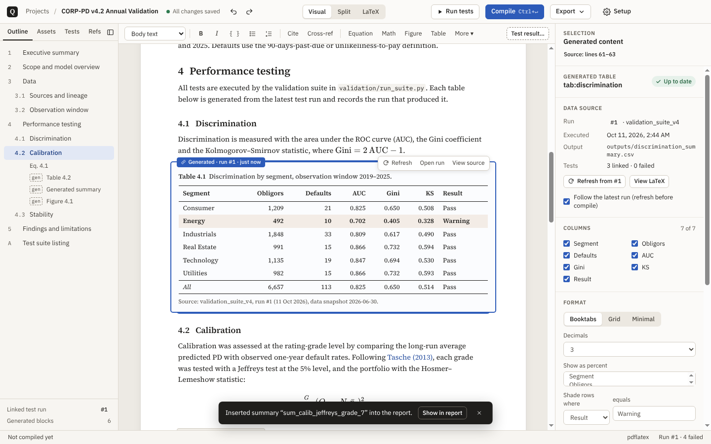

# TeXWriter

A Windows desktop app for writing model documentation and validation reports. You edit in a
word-processor view, switch to the LaTeX whenever you need exact control, pull test-suite
results into the report as linked tables, figures and sentences, and compile a reproducible PDF.

> The app, its installer and its project files still carry the working name **Quire**
> (`Quire-Setup-<version>.exe`, `quire.json`, `% quire:` markers in the LaTeX).



## Install and run

### Option A — installer
Download `Quire-Setup-<version>.exe` from the repository's **Releases** page and run it. The
installer is per-user (no admin rights needed), lets you choose the install folder, and adds a
Start menu entry; no desktop shortcut is created. Installing over an older version keeps your
settings and projects. The build is unsigned, so Windows SmartScreen may warn you; choose
**More info → Run anyway**.

Installers are built by GitHub Actions on a Windows runner (`.github/workflows/installer.yml`),
not checked into the repository:
- **Every push or pull request** builds the installer, installs it silently as a smoke test, and
  attaches it to the run: Actions → *Windows installer* → the run → **Artifacts**.
- **A release**: set `version` in `package.json`, commit, then push a matching tag
  (`git tag v0.2.4 && git push origin v0.2.4`). The workflow publishes the installer as a GitHub
  Release.
- **Locally on Windows**: `npm install && npm run dist` writes `release\Quire-Setup-<version>.exe`.
  (Cross-building from Linux needs a full 32-bit Wine setup; use the workflow instead.)

### Option B — from source
Requires Node.js 20 or newer.

```powershell
git clone https://github.com/sidiyer00/TeXWriter.git
cd TeXWriter
npm install          # downloads Electron (~100 MB) the first time
npm run dev          # development build with hot reload
npm run dist         # build the installer: release\Quire-Setup-<version>.exe
```

### Prerequisites for compiling and tests
| Tool | Needed for | Notes |
|---|---|---|
| **MiKTeX** or **TeX Live** | Compiling PDFs | pdfLaTeX is the default engine. MiKTeX's `latexmk` needs Perl; without it TeXWriter runs pdflatex → bibtex → pdflatex itself. MiKTeX can install missing packages during a compile. |
| **Python 3.9+** | Running the sample test suite | Standard library only. TeXWriter finds `python` on PATH; you can set a specific interpreter in Settings. |
| Git (optional) | Recording the commit on each run | |

The Home screen's "This computer" panel shows what was found; **Settings → LaTeX and Python**
(Ctrl+,) lists every tool with its path, lets you point at a specific TeX bin folder or Python,
and has **Detect again**. TeXWriter also re-checks when you switch back to it after installing
MiKTeX, so a fresh install is picked up without restarting.

### Where files go
New projects, the sample project and export dialogs use the **Projects folder** from
**Settings → General** (default `Documents\Quire`). Point it somewhere outside OneDrive if you
don't want projects synced. App settings live in `%APPDATA%\Quire`.

## The workflow

1. **Open the sample** (Home → Open sample project). This creates `CORP-PD-v4.2-Validation` in
   your projects folder: a full validation report and a Python suite.
2. **Run tests** (Ctrl+Shift+T). Each run goes into `runs\<n>\` with `results.json`, output CSVs
   and figures, and a log. The first run fills the report's generated tables.
3. **Review results** in Test runs. Filter, group, compare runs, look at a test's history, and
   insert a result as a table, a figure or a linked summary sentence.
4. **Edit** in Visual, Split or LaTeX mode (Ctrl+1/2/3). In Split view, the selected element and
   its source lines highlight each other.
5. **Compile** (Ctrl+Enter). Diagnostics link to the source line, are marked on the PDF page, and
   offer one-click fixes where possible: closest label or citation key, shrink a wide table,
   refresh stale content.
6. **Export** a PDF, a source bundle (.zip with sources, the runs used and PROVENANCE.json), or
   the provenance manifest on its own.

## How the visual editor stays faithful to the LaTeX

- **The `.tex` file is the single source of truth.** The visual editor parses the document body
  into blocks: headings, paragraphs, lists, equations, tables, figures, callouts, code, generated
  content. Anything it can't represent exactly becomes a *LaTeX block*, shown as source and kept
  byte-for-byte.
- **Untouched blocks keep their original bytes.** Only blocks you edit are re-serialized, so a
  visual edit never reformats the rest of the file.
- **Inline content follows the same rule.** Unknown commands (`\SI{..}`, `\textcolor{..}`) become
  inline LaTeX chips; citations and `\ref`/`\autoref` become chips that resolve against the
  bibliography and labels.
- **Generated content** is delimited in the source:
  ```latex
  % quire:generated id=tab_calib_grade
  \input{generated/tab_calib_grade.tex}
  % quire:end
  ```
  `quire.json` records which run, output file and tests each block came from. If someone edits
  that region by hand, TeXWriter reports a sync conflict: keep the edit (it becomes static LaTeX)
  or restore the generated version.
- **Document setup rewrites only two things:** the block between `% quire:theme begin/end` in
  `preamble.tex`, and the size and paper options of `\documentclass`. That block also carries the
  few support macros the editor emits (`\quirehl`, `\qnum`, …); older projects are upgraded
  automatically when opened.

## Connecting your own test suite

Set the test command in **Document setup → Compiler and tests**, e.g.

```
{python} validation/run_suite.py --out "{runDir}"
```

The command must write `results.json` into `{runDir}` (also exposed as `QUIRE_RUN_DIR`):

```json
{ "suite": "validation_suite_v4", "dataSnapshot": "2026-06-30",
  "tests": [ { "id": "calib.jeffreys.grade_7", "name": "Jeffreys test — Grade 7",
               "category": "Calibration", "status": "failed", "metric": "p-value",
               "value": 0.0088, "threshold": ">= 0.05", "notes": "35 defaults / 455",
               "outputs": ["outputs/calibration_by_grade.csv"],
               "details": { "obligors": 455, "defaults": 35 } } ] }
```

`validation/quire_report.py` (copied into every project that includes the sample suite) writes
this file for you. Print `QUIRE_PROGRESS <done>/<total> <label>` lines to drive the progress bar.
A JUnit XML file (`{runDir}/junit.xml`, e.g. from `pytest --junitxml`) also works, but only for
pass/fail status.

## Editing

- **Formatting**: bold, italic, underline (Ctrl+U), monospace, text colour and highlight
  (`\textcolor`, `\quirehl` via soul), links (`\href`). The toolbar moves its least-used buttons
  into **More** when the window is narrow instead of wrapping.
- **Find and replace** (Ctrl+F / Ctrl+H): all matches highlighted, match case / whole word /
  regex, Replace and Replace all (one undo step). In the LaTeX pane Ctrl+F uses CodeMirror's search.
- **Follow references**: Ctrl+click (or F12) a cross-reference to jump to its target, a citation
  to open its URL/DOI (or its BibTeX entry), a link to open it in the browser. Works in the LaTeX
  pane on `\ref`, `\cite`, `\input`, `\includegraphics` and `\url`, and on links in the PDF.
- **Equations**: the properties panel and the large editor (double-click an equation, or
  Maximize) suggest LaTeX commands as you type (`\su` → `\sum_{}^{}`), with a symbol palette.
- **Comments**: select text, Ctrl+Alt+M or right-click → New comment. Threads support replies,
  edits and resolve/reopen. They live in `quire-comments.json` in the project folder, so anyone
  opening the same folder sees them; anchors survive edits made in either view.
- **Files**: the Files tab in the navigator shows the whole project; click a `.tex`, `.sty`,
  `.cls`, `.bib` or script to open it in its own tab (Ctrl+O to search). Only the main file is
  open by default.
- **Panels and menus**: the right-hand **Properties / Comments** panel opens only when you ask
  (toolbar buttons, Ctrl+Alt+P / Ctrl+Alt+C, right-click → Properties); while it is open its own
  tabs replace the toolbar buttons, and × closes it. Right-click menus are available everywhere
  (spelling suggestions, formatting, table operations, follow reference, show in source); their
  submenus open on click.

### Tables

Insert → Table (Ctrl+Alt+T) gives an editable table. Existing `tabular` environments open in the
same editor when TeXWriter can represent them; anything else stays an editable LaTeX block.

- **Structure**: insert/delete rows and columns, merge and split cells, select a whole row or
  column, header rows (several header rows with merged cells print as multi-level headers with
  `\cmidrule`), cell colours (`\cellcolor`).
- **Styles**: Booktabs, Striped, Horizontal lines, Minimal, Boxed, Grid, Plain.
- **Options** (Properties panel or the table toolbar's More menu): text size (normal → script),
  row spacing (`\arraystretch`), header shading, caption above/below, placement, and per-column
  alignment — left, centre, right, or wrap at a fixed width (`p{3cm}`).
- **Number formats, Excel-style**: a body cell can be Text, Integer, Number, Percentage, Currency
  ($ € £ ¥) or Scientific, shown to a number of **decimal places or significant figures**, with an
  optional thousands separator and four styles for negatives (−1,234.10, (1,234.10), either in
  red). The table toolbar has a format picker, increase/decrease decimal, a thousands toggle, a
  **Format…** dialog (with preview, for the selection or a whole column) and a value box that shows
  the cell's full-precision value. Rounding is exact (1.005 → 1.01) and the full value is always
  kept, so reducing and restoring decimals never loses digits. A number typed into a formatted
  cell takes the format when you leave the cell. In the LaTeX a formatted cell is
  `\qnum[pct,d1]{0.12345}{12.3\%}`, which prints only the last argument and needs no extra packages.
- The table toolbar floats over the page, so clicking into a table never shifts the document.
- **Multi-level headers**: **+ Header level** (table toolbar or right-click → Table) adds a header
  row above the table; select the cells a group label covers and **Merge cells**. Merged header
  cells print as `\multicolumn` with `\cmidrule` (booktabs, striped) or `\cline` (minimal,
  boxed); a header cell merged down uses `\multirow`, and grid/lines rules skip it.

### Spreadsheets and CSV files

- **Paste from Excel, Google Sheets or Numbers** (Ctrl+V) anywhere in the visual editor: the range
  becomes an editable table. Merged cells are kept, so a two-row "group / column" header pastes as
  a multi-level header; header rows are detected (all-text rows above numeric data). Comma- or
  semicolon-separated text with the same number of fields on every line is converted too; prose
  with commas is not. The toast offers **Paste as text**, and **Ctrl+Shift+V** always pastes plain
  text. Pasted into an existing table, tab-separated cells fill the table from the cursor.
- **Pick the style** from the Table toolbar's style menu (Booktabs, Striped, Horizontal lines,
  Minimal, Boxed, Grid, Plain). New pasted and converted tables use the last style you picked.
- **Copy to Excel**: Ctrl+C on selected cells or a whole table puts tab-separated text on the
  clipboard, one value per cell. **Copy table for Excel** (table toolbar → More, or right-click →
  Table) also writes an HTML table, so Excel and Sheets keep merged header cells.
- **Paste into the LaTeX pane**: spreadsheet cells pasted into a `.tex` file become a `tabular`.
- **Tables from CSV files**: Insert → **Table from data file (CSV)…**, or right-click a `.csv` in
  the Files tab → Insert as table. Choose header rows (or let them be detected), style, text size
  and a number format (e.g. 2 decimals with thousands separators; the full value is kept in
  `\qnum`). **Linked** (the default) writes `generated/<id>.tex` and inserts
  ```latex
  % quire:generated id=tab_grades_2025
  \input{generated/tab_grades_2025.tex}
  % quire:end
  ```
  The table is rewritten whenever the CSV changes on disk (re-export from Python, R or Excel and it
  follows), and before each compile. Its Properties panel picks columns, style, header rows,
  number format, caption and label; **Convert to editable table** unlinks it. **Editable copy**
  converts the file once into an ordinary table. CSV, TSV and semicolon-separated files work.

### Templates

- **Built-in**: model risk (validation, documentation, monitoring, performance review), academic
  (journal article, conference paper in two columns, working paper with JEL codes, thesis or
  dissertation on the `report` class with chapters, APA 7 paper, research proposal) and general
  (technical report, blank). Each sets its class, citation style (numbered or author–year),
  numbering and Document setup values (font, size, spacing, margins).
- **Your own**: File → **Save as template…** keeps the current project's **layout** (class,
  preamble, `.sty`/`.cls` files, front matter and headings; either the structure with placeholder
  text or all the text) and/or its **style** (Document setup values). Document setup → **Save as
  style…** saves just the style; saved styles appear next to the built-in themes. Home → Your
  templates → **Import .tex template…** turns a journal's or university's `.tex` file (plus the
  class, style and `.bst` files next to it) into a template; its class options are left alone.
  New projects from a template get the new title and author filled in. Templates are JSON files in
  `%APPDATA%\Quire\templates`; copy one into a colleague's folder to share it.

## Keyboard and window

Press **F1** (or Settings → Keyboard shortcuts) for the full list. Shortcuts are fixed and use
**Ctrl** only: combinations with the Windows key (Win+S, Win+Shift+S, Win+1…, Win+Up) are always
left to Windows, and AltGr still types characters. The main ones:

| Shortcut | Action |
|---|---|
| Ctrl+1 / 2 / 3 | Visual / Split / LaTeX |
| Ctrl+Enter | Compile |
| Ctrl+Shift+T | Run tests |
| Ctrl+S | Save now and confirm (autosave is also on) |
| Ctrl+F / Ctrl+H | Find / find and replace |
| Ctrl+B / I / U | Bold / italic / underline |
| Ctrl+M / Ctrl+Shift+M | Inline math / display equation |
| Ctrl+Alt+T | Insert table |
| Ctrl+Alt+M | New comment |
| Ctrl+Alt+P / Ctrl+Alt+C | Properties / comments panel |
| Ctrl+click, F12 | Follow reference, citation or link |
| Ctrl+O | Open a file in the project |
| F8 / Shift+F8 | Next / previous issue |
| Ctrl+\ | Collapse navigator |
| Double-click PDF | Jump to source (SyncTeX) |

The window uses the normal Windows maximize (title-bar button, double-click, Win+Up, Snap), has
square corners, keeps an auto-hide taskbar reachable, and reopens at its last size and
maximized state.

## Project layout

```
TeXWriter/
  src/shared/        pure TypeScript: LaTeX block parser/serializer, tables and number
                     formats, log parser, results schema, theme → preamble
  src/main/          Electron main: window, projects, compile (latexmk + fallback), runs, export
  src/renderer/      React UI: TipTap visual editor, CodeMirror source, pdf.js review
  resources/sample/  sample report + stdlib Python validation suite
  tests/             unit tests (npm test)
  scripts/e2e.mjs    end-to-end run through the whole workflow (Playwright + Electron)
```

`npm run typecheck` and `npm test` run the type check and unit tests. `npm run build && npm run
e2e` drives the app through the full workflow (sample → run → insert → split edit → compile →
tables and number formats → comments → setup) and writes screenshots to `e2e-shots/`.
`npm run e2e:tables` covers spreadsheet paste/copy, CSV-linked tables and templates, compiling
each new template.

## Known limits (v0.2.3)

- Hand-written tables using `tabularx`, `longtable`, `@{}`/`>{}` column specs or siunitx `S`
  columns stay LaTeX blocks (still editable in source). Number formats apply to body cells, not
  header cells.
- Comments are shared through the project folder (last writer wins if two people edit the same
  comment file at the same moment); there is no live co-editing.
- The in-editor equation preview uses KaTeX. A few LaTeX-only macros show a preview error but
  still compile.
- When a theme font is missing, TeXWriter falls back to Computer Modern and lists the missing
  package as a notice.
- The installer is unsigned (SmartScreen warns on first run) and there is no auto-update yet. No PDF/A output; the provenance
  manifest records SHA-256 hashes of every source behind the PDF.
