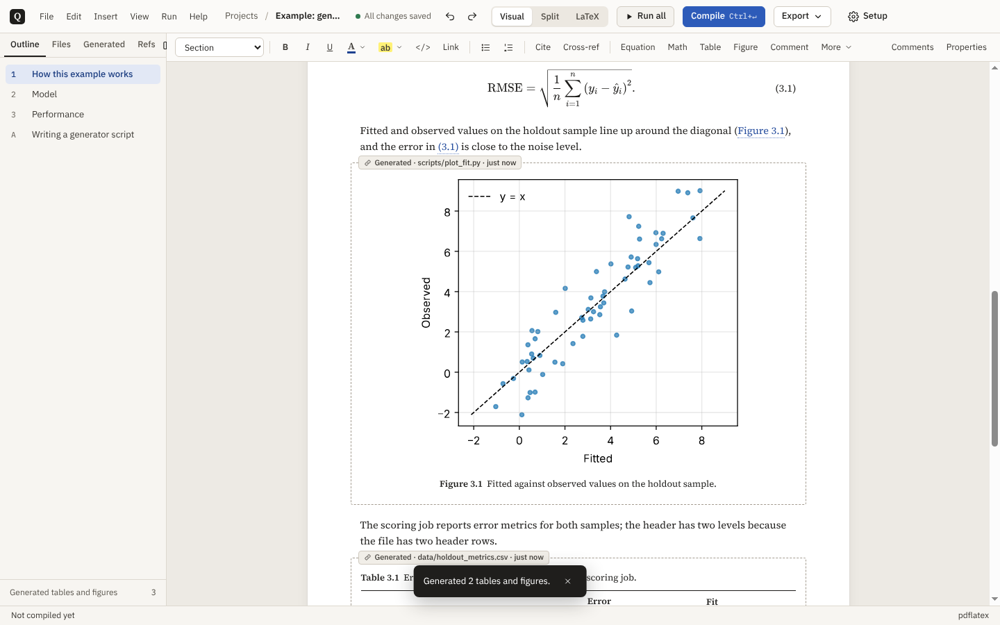
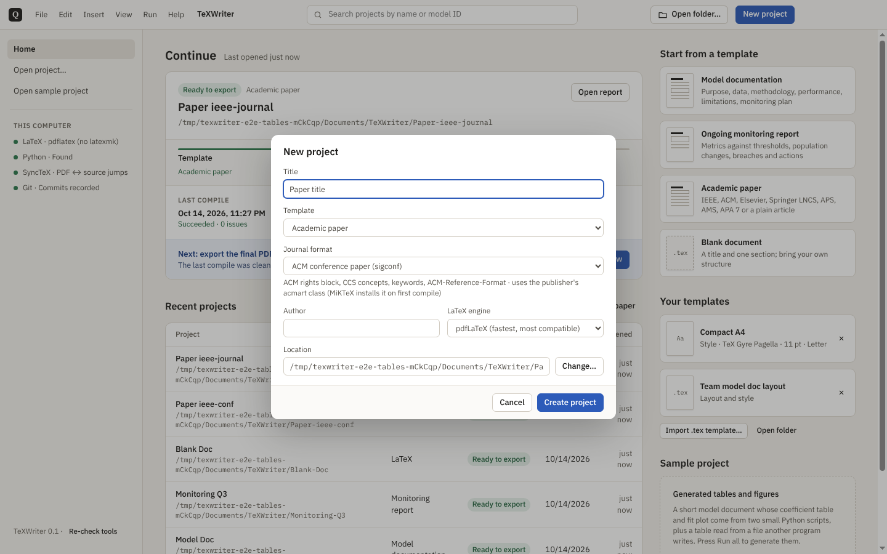
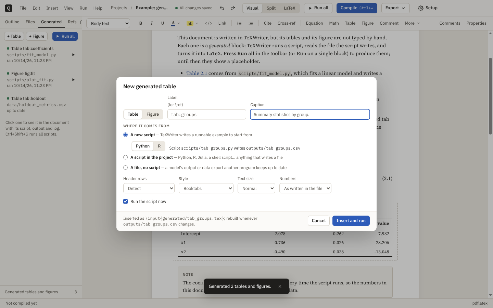
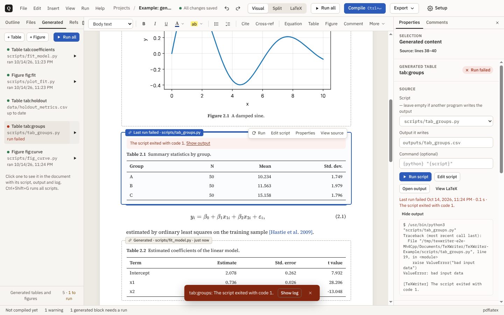

# TeXWriter

A Windows desktop LaTeX editor. You write in a word-processor view, switch to the LaTeX whenever
you need exact control, and compile a reproducible PDF. Tables and figures can be **generated**:
paired with a script (Python, R, anything) or with a file another program writes, and rebuilt
when you run the script or the file changes. Excel ranges paste in as tables.



## Install and run

### Option A — installer
Download `TeXWriter-Setup-<version>.exe` from the repository's **Releases** page and run it. The
installer is per-user (no admin rights needed), lets you choose the install folder, and adds a
Start menu entry; no desktop shortcut is created. Installing over an older version keeps your
settings and projects. The build is unsigned, so Windows SmartScreen may warn you; choose
**More info → Run anyway**.

Installers are built by GitHub Actions on a Windows runner (`.github/workflows/installer.yml`),
not checked into the repository:
- **Every push or pull request** builds the installer, installs it silently as a smoke test, and
  attaches it to the run: Actions → *Windows installer* → the run → **Artifacts**.
- **Releases**: every push to `main` publishes the installer on the GitHub Release
  `v<version>` (the `version` in `package.json`), creating the release and tag if needed. Bump the
  version for a new release; without a bump the installer on the current release is refreshed.
- **Locally on Windows**: `npm install && npm run dist` writes `release\TeXWriter-Setup-<version>.exe`.
  (Cross-building from Linux needs a full 32-bit Wine setup; use the workflow instead.)

### Option B — from source
Requires Node.js 20 or newer.

```powershell
git clone https://github.com/sidiyer00/TeXWriter.git
cd TeXWriter
npm install          # downloads Electron (~100 MB) the first time
npm run dev          # development build with hot reload
npm run dist         # build the installer: release\TeXWriter-Setup-<version>.exe
```

### Prerequisites
| Tool | Needed for | Notes |
|---|---|---|
| **MiKTeX** or **TeX Live** | Compiling PDFs | pdfLaTeX is the default engine. MiKTeX's `latexmk` needs Perl; without it TeXWriter runs pdflatex → bibtex → pdflatex itself. MiKTeX installs missing packages (including the journal classes) during a compile. |
| **Python 3.9+** | Python scripts behind generated tables and figures | The sample's figure also needs matplotlib (`pip install matplotlib`). TeXWriter finds `python` on PATH; set another interpreter in Settings or per project in Document setup. |
| R, Julia, … (optional) | Scripts in those languages | Run with `Rscript`, `julia`, … from PATH, or any command you set on the block. |

The Home screen's "This computer" panel shows what was found; **Settings → LaTeX and Python**
(Ctrl+,) lists every tool with its path, lets you point at a specific TeX bin folder or Python,
and has **Detect again**. TeXWriter also re-checks when you switch back to it after installing
MiKTeX, so a fresh install is picked up without restarting.

### Where files go
New projects, the sample project and export dialogs use the **Projects folder** from
**Settings → General** (default `Documents\TeXWriter`). Point it somewhere outside OneDrive if you
don't want projects synced. App settings live in `%APPDATA%\TeXWriter`.

### Coming from Quire
TeXWriter was called Quire. It installs as a separate app (uninstall Quire from Windows
Settings → Apps when you no longer need it). On first start it copies Quire's settings, recent
projects and saved templates. Quire projects open as they are: `quire.json`, `.quire\` and
`quire-comments.json` are renamed to `texwriter.json`, `.texwriter\` and
`texwriter-comments.json`; `% quire:` markers, `\quirehl` and the `quirecallout` environment
keep working, and the managed preamble block is upgraded. Blocks that came from Quire's test
runs keep showing the run's output file; pair them with a script in their properties.

## The workflow

1. **Start a project** from a template (Home → Start from a template) or open the sample (Home →
   Open sample project): a short model document whose tables and figure come from scripts.
2. **Write** in Visual, Split or LaTeX mode (Ctrl+1/2/3). In Split view, the selected element and
   its source lines highlight each other.
3. **Add generated tables and figures** (Insert → Generated table / Generated figure, or the
   Generated tab) and **Run all** (Ctrl+Shift+G) to produce them.
4. **Compile** (Ctrl+Enter). Diagnostics link to the source line, are marked on the PDF page, and
   offer one-click fixes where possible: closest label or citation key, shrink a wide table, run a
   block's script.
5. **Export** a PDF, a source bundle (.zip with sources, scripts, outputs and PROVENANCE.json), or
   the provenance manifest on its own.

## Templates

| Template | What you get |
|---|---|
| **Model documentation** | Purpose and use, model overview, data, methodology, performance, implementation, limitations, monitoring plan, appendix. Page layout from Document setup. |
| **Ongoing monitoring report** | Summary, scope, performance metrics against thresholds, data and population, breaches and actions, conclusion. |
| **Academic paper** | Choose a journal format (below). Each uses the publisher's own class with its front matter and reference style, so the PDF has the journal's layout. |
| **Blank document** | A title and one section. |



| Journal format | Class | Front matter and references |
|---|---|---|
| IEEE conference paper | `IEEEtran` `[conference]` | IEEE author blocks, `IEEEkeywords`, `IEEEtran.bst` |
| IEEE journal article | `IEEEtran` `[journal]` | membership and `\thanks` notes, `\markboth` running heads |
| ACM conference paper | `acmart` `[sigconf]` | rights block, CCS concepts, keywords, `ACM-Reference-Format` |
| Elsevier journal | `elsarticle` `[preprint,12pt]` | `frontmatter` with affiliations and `keyword`, `elsarticle-num` |
| Springer LNCS | `llncs` `[runningheads]` | `\institute`, ORCID, keywords in the abstract, `splncs04` |
| APS Physical Review | `revtex4-2` `[aps,prl,reprint]` | superscript affiliations, `apsrev4-2` |
| AMS journal article | `amsart` | `\address`, MSC `\subjclass`, theorem environments, `amsplain` |
| APA 7 manuscript | `apa7` `[man,natbib]` | title page, running head, abstract and keywords, `apacite` |
| Plain article | `article` | working papers and preprints; layout from Document setup |

For journal formats the class owns the layout: Document setup shows the class instead of page,
font and header settings, and `preamble.tex` only loads what the editor's features use
(graphicx, booktabs, xcolor, …). Change class options such as `[review]` on the first line of
the `.tex` file. All these classes are on CTAN; MiKTeX installs them on the first compile.
Journals that publish their own class files (NeurIPS, AEA, …) can be added as your own template
with **Import .tex template**.

**Your own templates**: File → **Save as template…** keeps the current project's **layout** (class,
preamble, `.sty`/`.cls` files, front matter and headings; either the structure with placeholder
text or all the text) and/or its **style** (Document setup values). Document setup → **Save as
style…** saves just the style. Home → Your templates → **Import .tex template…** turns a journal's
or university's `.tex` file (plus the class, style and `.bst` files next to it) into a template;
its class options are left alone. New projects from a template get the new title and author.
Templates are JSON files in `%APPDATA%\TeXWriter\templates`; copy one to a colleague to share it.

## Generated tables and figures

A generated table or figure is rebuilt from an **output file**:

- **written by a script** paired with the block (Python, R, Julia, a shell script… anything that
  writes a file), or
- **written by something else**: a model's scoring job, a data export, a file you edit in Excel.
  The block follows the file and updates whenever it changes.

| Output | Becomes |
|---|---|
| `.csv`, `.tsv`, `.txt` | a table in any of the editor's styles, with header detection, multi-level headers (two header rows in the file), number formats and column choice |
| `.tex` | the LaTeX table the script wrote (a bare `tabular` is wrapped in a table with your caption and label) |
| `.pdf`, `.png`, `.jpg`, `.eps` | a figure (`\includegraphics`) at the width you choose |



**Adding one.** Insert → **Generated table…** or **Generated figure…** (or **+ Table** / **+ Figure**
in the navigator's Generated tab). Give it a label and caption and choose where it comes from:

- **A new script**: TeXWriter writes a runnable starter script (Python or R) to
  `scripts/<id>.py` that produces an example table or plot. Run it, then replace the example with
  your own code.
- **A script in the project**, with the file it writes and, if needed, the command that runs it.
  Right-click a script in the Files tab for the same.
- **A file, no script**: pick the output file (or **Import…** it). For a table you can also convert
  it once into an ordinary editable table.

The document gets

```latex
% texwriter:generated id=tab_coefficients
\input{generated/tab_coefficients.tex}
% texwriter:end
```

and a placeholder with the caption and label until the output exists, so `\ref` resolves and the
document compiles from the start.

**Running.** **Run** on a block (or in the Generated tab, or its properties) runs its script;
**Run all** (toolbar, Ctrl+Shift+G) runs every script in turn. A script runs with the project
folder as its working directory and these environment variables:

| Variable | Value |
|---|---|
| `TEXWRITER_OUTPUT` | absolute path of the file it should write |
| `TEXWRITER_PROJECT` | absolute path of the project folder |
| `TEXWRITER_ID` | the block's id |

```python
import csv, os
with open(os.environ["TEXWRITER_OUTPUT"], "w", newline="") as f:
    csv.writer(f).writerows([["Model", "RMSE"], ["Linear", 1.04]])
```

The default command comes from the script's extension: `{python} "{script}"` for `.py`,
`Rscript "{script}"` for `.R`, `julia`, `node`, `bash`, PowerShell. Set your own per block, with
`{python}`, `{script}` and `{output}` filled in. A run succeeds when the command exits with 0 and
the output file was written; otherwise the block is marked **failed**, keeps showing the previous
output, and its properties show the script's output (the Python traceback, the R error…).



**Document setup → Generated content** sets the Python interpreter, a time limit per script, and
whether to run every script before each compile (by default compiling only re-reads the outputs,
which is instant).

**Properties** of a block: the script, output and command; Run, Edit script, Open output, the last
run's time and log; for tables the header rows, style, text size, number format, columns to show
and fit-to-width; for figures the width; caption and label. **Convert to static LaTeX** keeps the
current LaTeX in the document and stops regenerating it.

## How the visual editor stays faithful to the LaTeX

- **The `.tex` file is the single source of truth.** The visual editor parses the document body
  into blocks: headings, paragraphs, lists, equations, tables, figures, callouts, code, generated
  content. Anything it can't represent exactly becomes a *LaTeX block*, shown as source and kept
  byte-for-byte.
- **Untouched blocks keep their original bytes.** Only blocks you edit are re-serialized, so a
  visual edit never reformats the rest of the file.
- **Inline content follows the same rule.** Unknown commands (`\SI{..}`, `\textcolor{..}`) become
  inline LaTeX chips; citations and `\ref`/`\autoref` become chips that resolve against the
  bibliography and labels.
- **Generated content** is delimited in the source:
  ```latex
  % texwriter:generated id=tab_coefficients
  \input{generated/tab_coefficients.tex}
  % texwriter:end
  ```
  `texwriter.json` records each block's script, output file, options and last run. If someone
  edits that region (or `generated/<id>.tex`) by hand, TeXWriter reports a sync conflict: keep the
  edit (it becomes static LaTeX) or restore the generated version.
- **Document setup rewrites only two things:** the block between `% texwriter:theme begin/end` in
  `preamble.tex`, and the size and paper options of `\documentclass`. That block also carries the
  few support macros the editor emits (`\texwriterhl`, `\qnum`, …); older projects are upgraded
  automatically when opened.

## Editing

- **Formatting**: bold, italic, underline (Ctrl+U), monospace, text colour and highlight
  (`\textcolor`, `\texwriterhl` via soul), links (`\href`). The toolbar moves its least-used buttons
  into **More** when the window is narrow instead of wrapping.
- **Find and replace** (Ctrl+F / Ctrl+H): all matches highlighted, match case / whole word /
  regex, Replace and Replace all (one undo step). In the LaTeX pane Ctrl+F uses CodeMirror's search.
- **Follow references**: Ctrl+click (or F12) a cross-reference to jump to its target, a citation
  to open its URL/DOI (or its BibTeX entry), a link to open it in the browser. Works in the LaTeX
  pane on `\ref`, `\cite`, `\input`, `\includegraphics` and `\url`, and on links in the PDF.
- **Equations**: the properties panel and the large editor (double-click an equation, or
  Maximize) suggest LaTeX commands as you type (`\su` → `\sum_{}^{}`), with a symbol palette.
- **Comments**: select text, Ctrl+Alt+M or right-click → New comment. Threads support replies,
  edits and resolve/reopen. They live in `texwriter-comments.json` in the project folder, so anyone
  opening the same folder sees them; anchors survive edits made in either view.
- **Files**: the Files tab in the navigator shows the whole project; click a `.tex`, `.sty`,
  `.cls`, `.bib` or script to open it in its own tab (Ctrl+O to search). Only the main file is
  open by default.
- **Panels and menus**: the right-hand **Properties / Comments** panel opens only when you ask
  (toolbar buttons, Ctrl+Alt+P / Ctrl+Alt+C, right-click → Properties); while it is open its own
  tabs replace the toolbar buttons, and × closes it. Right-click menus are available everywhere
  (spelling suggestions, formatting, table operations, follow reference, show in source); their
  submenus open on click.

### Tables

Insert → Table (Ctrl+Alt+T) gives an editable table. Existing `tabular` environments open in the
same editor when TeXWriter can represent them; anything else stays an editable LaTeX block.

- **Structure**: insert/delete rows and columns, merge and split cells, select a whole row or
  column, header rows (several header rows with merged cells print as multi-level headers with
  `\cmidrule`), cell colours (`\cellcolor`).
- **Styles**: Booktabs, Striped, Horizontal lines, Minimal, Boxed, Grid, Plain.
- **Options** (Properties panel or the table toolbar's More menu): text size (normal → script),
  row spacing (`\arraystretch`), header shading, caption above/below, placement, and per-column
  alignment — left, centre, right, or wrap at a fixed width (`p{3cm}`).
- **Number formats, Excel-style**: a body cell can be Text, Integer, Number, Percentage, Currency
  ($ € £ ¥) or Scientific, shown to a number of **decimal places or significant figures**, with an
  optional thousands separator and four styles for negatives (−1,234.10, (1,234.10), either in
  red). The table toolbar has a format picker, increase/decrease decimal, a thousands toggle, a
  **Format…** dialog (with preview, for the selection or a whole column) and a value box that shows
  the cell's full-precision value. Rounding is exact (1.005 → 1.01) and the full value is always
  kept, so reducing and restoring decimals never loses digits. A number typed into a formatted
  cell takes the format when you leave the cell. In the LaTeX a formatted cell is
  `\qnum[pct,d1]{0.12345}{12.3\%}`, which prints only the last argument and needs no extra packages.
- The table toolbar floats over the page, so clicking into a table never shifts the document.
- **Multi-level headers**: **+ Header level** (table toolbar or right-click → Table) adds a header
  row above the table; select the cells a group label covers and **Merge cells**. Merged header
  cells print as `\multicolumn` with `\cmidrule` (booktabs, striped) or `\cline` (minimal,
  boxed); a header cell merged down uses `\multirow`, and grid/lines rules skip it.

### Spreadsheets and CSV files

- **Paste from Excel, Google Sheets or Numbers** (Ctrl+V) anywhere in the visual editor: the range
  becomes an editable table. Merged cells are kept, so a two-row "group / column" header pastes as
  a multi-level header; header rows are detected (all-text rows above numeric data). Comma- or
  semicolon-separated text with the same number of fields on every line is converted too; prose
  with commas is not. The toast offers **Paste as text**, and **Ctrl+Shift+V** always pastes plain
  text. Pasted into an existing table, tab-separated cells fill the table from the cursor.
- **Pick the style** from the Table toolbar's style menu (Booktabs, Striped, Horizontal lines,
  Minimal, Boxed, Grid, Plain). New pasted and converted tables use the last style you picked.
- **Copy to Excel**: Ctrl+C on selected cells or a whole table puts tab-separated text on the
  clipboard, one value per cell. **Copy table for Excel** (table toolbar → More, or right-click →
  Table) also writes an HTML table, so Excel and Sheets keep merged header cells.
- **Paste into the LaTeX pane**: spreadsheet cells pasted into a `.tex` file become a `tabular`.
- **Tables from CSV files**: Insert → **Table from data file (CSV)…**, or right-click a `.csv` in
  the Files tab → Insert as table. Choose header rows (or let them be detected), style, text size
  and a number format (e.g. 2 decimals with thousands separators; the full value is kept in
  `\qnum`). **Linked** (the default) writes `generated/<id>.tex` and inserts
  ```latex
  % texwriter:generated id=tab_grades_2025
  \input{generated/tab_grades_2025.tex}
  % texwriter:end
  ```
  The table is rewritten whenever the CSV changes on disk (re-export from Python, R or Excel and it
  follows), and before each compile. Its Properties panel picks columns, style, header rows,
  number format, caption and label; **Convert to editable table** unlinks it. **Editable copy**
  converts the file once into an ordinary table. CSV, TSV and semicolon-separated files work.

## Keyboard and window

Press **F1** (or Settings → Keyboard shortcuts) for the full list. Shortcuts are fixed and use
**Ctrl** only: combinations with the Windows key (Win+S, Win+Shift+S, Win+1…, Win+Up) are always
left to Windows, and AltGr still types characters. The main ones:

| Shortcut | Action |
|---|---|
| Ctrl+1 / 2 / 3 | Visual / Split / LaTeX |
| Ctrl+Enter | Compile |
| Ctrl+Shift+G | Run all scripts of generated tables and figures |
| Ctrl+S | Save now and confirm (autosave is also on) |
| Ctrl+F / Ctrl+H | Find / find and replace |
| Ctrl+B / I / U | Bold / italic / underline |
| Ctrl+M / Ctrl+Shift+M | Inline math / display equation |
| Ctrl+Alt+T | Insert table |
| Ctrl+Alt+M | New comment |
| Ctrl+Alt+P / Ctrl+Alt+C | Properties / comments panel |
| Ctrl+click, F12 | Follow reference, citation or link |
| Ctrl+O | Open a file in the project |
| F8 / Shift+F8 | Next / previous issue |
| Ctrl+\ | Collapse navigator |
| Double-click PDF | Jump to source (SyncTeX) |

The window uses the normal Windows maximize (title-bar button, double-click, Win+Up, Snap), has
square corners, keeps an auto-hide taskbar reachable, and reopens at its last size and
maximized state.

## Project layout

```
TeXWriter/
  src/shared/        pure TypeScript: LaTeX block parser/serializer, tables and number
                     formats, log parser, generated tables/figures, theme → preamble
  src/main/          Electron main: window, projects, templates, compile (latexmk + fallback),
                     running generator scripts, export
  src/renderer/      React UI: TipTap visual editor, CodeMirror source, pdf.js review
  resources/sample/  sample document with generator scripts and data
  tests/             unit tests (npm test)
  scripts/e2e.mjs    end-to-end run through the whole workflow (Playwright + Electron)
```

`npm run typecheck` and `npm test` run the type check and unit tests. `npm run build && npm run
e2e` drives the app through the full workflow (sample → Run all → new generated table and figure
from starter scripts → a failing script and its log → split edit → compile → tables and number
formats → comments → setup) and writes screenshots to `e2e-shots/`.
`npm run e2e:tables` covers spreadsheet paste/copy, file-linked tables and templates, compiling
each new template.

## Known limits (v0.3.0)

- Hand-written tables using `tabularx`, `longtable`, `@{}`/`>{}` column specs or siunitx `S`
  columns stay LaTeX blocks (still editable in source). Number formats apply to body cells, not
  header cells.
- Comments are shared through the project folder (last writer wins if two people edit the same
  comment file at the same moment); there is no live co-editing.
- The in-editor equation preview uses KaTeX. A few LaTeX-only macros show a preview error but
  still compile.
- When a theme font is missing, TeXWriter falls back to Computer Modern and lists the missing
  package as a notice.
- Generator scripts run one at a time, on this computer, with your user's permissions: only pair
  blocks with scripts you trust. There is no per-script virtual environment; set the project's
  Python interpreter (e.g. a venv's `python.exe`) in Document setup → Generated content.
- Generated text (numbers inside sentences) is not supported; generate a small table instead,
  or write the sentence in the script's `.tex` output.
- Journal classes that are not on CTAN (NeurIPS, ICML, AEA…) are not built in; import the
  journal's template with Home → Import .tex template.
- The installer is unsigned (SmartScreen warns on first run) and there is no auto-update yet. No
  PDF/A output; the provenance manifest records SHA-256 hashes of every source behind the PDF.
